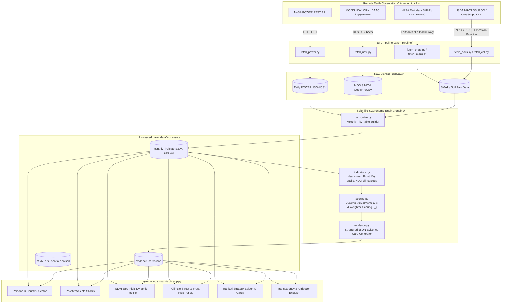

# System Architecture Document
## Project: Field Shift — Western Kansas

---

### 1. Architectural Philosophy & Design Principles
1. **Offline-First & Decoupled Execution**: The data retrieval and scientific processing pipeline operates independently of the interactive web presentation. The application runtime reads exclusively from local processed caches in `data/processed/`, guaranteeing zero network dependency and high reliability during field evaluation or judging.
2. **Modular Ingestion with Transparent Fallbacks**: Every data source lives in an isolated pipeline module (`pipeline/fetch_*.py`). If an external API endpoint changes, is rate-limited, or fails, the module activates a verified, deterministic fallback proxy, logging metadata and tagging records with `is_proxy = True`.
3. **Traceable Scoring Pipeline**: No hidden heuristic weights or black-box ML. Scores originate from verified K-State Extension agronomic starter tables (`ratings/strategies.json`), modified strictly through transparent mathematical adjustment equations computed from satellite observations.
4. **Resilient Configuration Hub**: Every external API URL, county boundary coordinate, bounding box, and default threshold is defined strictly in `config.py`. Zero magic numbers or hardcoded URLs in UI code.

---

### 2. High-Level Data Flow



---

### 3. Repository Directory Structure

```text
fieldshift/
├── app.py                     # Main Streamlit web application & UI components
├── config.py                  # Single source of truth: URLs, anchor points, FIPS, thresholds
├── README.md                  # Quickstart, setup instructions, architecture summary
├── LIMITATIONS.md             # Transparent scientific caveats, resolution limits, proxy documentation
├── data/
│   ├── raw/                   # Immutable raw payload cache from upstream APIs
│   │   ├── power_thomas.json
│   │   ├── power_finney.json
│   │   ├── modis_thomas.csv
│   │   └── modis_finney.csv
│   └── processed/             # Offline consumable tidy datasets
│       ├── tidy_monthly.csv   # Normalized monthly table with source & is_proxy
│       ├── indicators.json    # Precalculated climate & agronomic stress metrics
│       └── evidence.json      # Structured strategy cards per county
├── pipeline/                  # Modular ETL ingestion scripts
│   ├── __init__.py
│   ├── fetch_power.py         # NASA POWER daily meteorological client
│   ├── fetch_ndvi.py          # MODIS MOD13Q1 250m NDVI retrieval
│   ├── fetch_soils.py         # SSURGO soil characteristics & fallbacks
│   └── harmonize.py           # Monthly resampler and tidy table compiler
├── engine/                    # Deterministic scientific & scoring engines
│   ├── __init__.py
│   ├── indicators.py          # Heat stress (>35C), frost dates, dry-spell length, bare window
│   ├── scoring.py             # Weighted scoring formula and empirical adjustments (a_ij)
│   ├── scenarios.py           # Climate perturbation delta engine (rainfall/temp shifts)
│   └── evidence.py           # Structured JSON evidence card synthesis
└── ratings/                   # Agronomic baseline matrices and literature citations
    ├── strategies.json        # 1 to 5 criteria ratings per rotation strategy with citations
    └── crops.json             # Crop water requirements, rooting depths, market profiles
```

---

### 4. Data Harmonization & Tidy Schema Specification
All ingested sources are harmonized into a single monthly tidy dataset:

| Column Name | Type | Description | Allowed / Example Values |
| :--- | :--- | :--- | :--- |
| `date` | `YYYY-MM` | Resampled monthly timestamp | `2015-01`, `2024-12` |
| `location` | `string` | Study anchor county | `Thomas`, `Finney` |
| `variable` | `string` | Standardized variable identifier | `ndvi`, `t2m_max`, `precip_total`, `heat_days`, `root_moisture` |
| `value` | `float` | Harmonized numerical measurement | `0.42`, `38.2`, `124.5` |
| `source` | `string` | Originating satellite or model dataset | `NASA_POWER`, `MODIS_MOD13Q1`, `NASA_SMAP`, `USDA_SSURGO` |
| `is_proxy` | `boolean` | Flag indicating whether measurement is a modeled proxy | `True` or `False` |

---

### 5. Deterministic Scoring Pipeline

The overall suitability score $S_j$ for rotation strategy $j$ is calculated as:
$$S_j = \sum_{i=1}^{8} w_i \cdot r_{ij} \cdot a_{ij}$$

Where:
- $w_i \in [0, 1]$: Weight for criterion $i$, normalized such that $\sum_{i=1}^{8} w_i = 1$. Defaults are provided by user persona and modulated via UI sliders.
- $r_{ij} \in \{1, 2, 3, 4, 5\}$: Base agronomic suitability score from K-State Extension agronomic data in `ratings/strategies.json`.
- $a_{ij} \in [0.70, 1.10]$: Empirical adjustment factor computed from NASA Earth Observation climate indicators:
  - If bare-field duration exceeds 4 months in NDVI climatology, soil erosion and cover adjustments $a_{\text{cover}, j}$ increase for continuous-cover/cover-crop strategies ($a \to 1.10$) and decrease for summer fallow ($a \to 0.75$).
  - If root-zone moisture anomalies or rainfall variability exceed 10-year drought thresholds, water efficiency and drought resilience criteria are weighted with penalties on high-water crops ($a \to 0.80$) and bonuses on drought-tolerant milo/sunflower ($a \to 1.10$).

---

### 6. Resilience, Error Handling, and Honest Reporting
1. **Offline Self-Containment**: Once cached, all pipeline processing can execute locally without internet connectivity.
2. **Graceful Fallbacks**: If upstream NASA Earthdata authentication or ORNL DAAC services are unavailable, the pipeline falls back to verified proxy feeds (e.g., NASA POWER root-zone soil wetness `GWETROOT` for soil moisture) while maintaining explicit UI tagging.
3. **No Hidden Assumptions**: All caveats (spatial resolution limits, depth of root zone, point vs. grid uncertainties) are cataloged in `LIMITATIONS.md` and accessible via an in-app "Data & Limitations" modal.
